<div align="center">

# Rust Genetics Lab

**Inventory-aware breeding routes and practical farm plans for Rust.**

[](package.json)


[](src/tests)
[](LICENSE)
[](https://github.com/JawadYzbk/rust-genetics-lab/stargazers)

Turn a clone box into a breeding route. Size the farm, find its bottleneck, and carry the plan into the game.

</div>

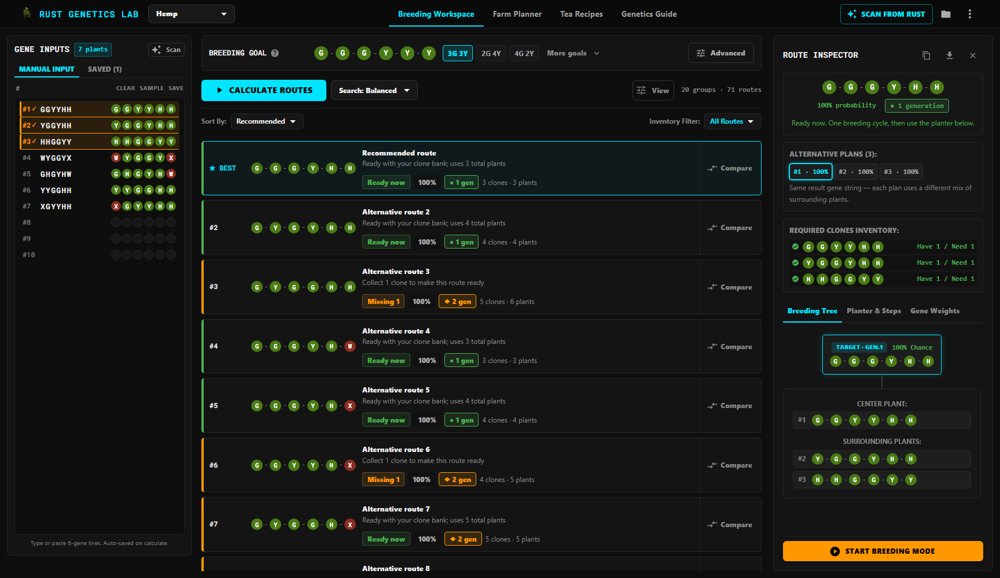

<details>
<summary>Additional screenshots</summary>

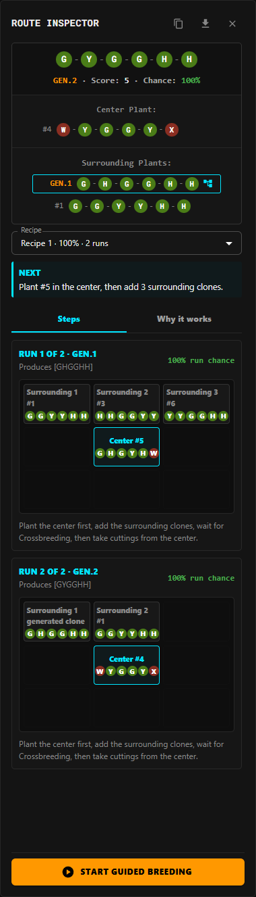

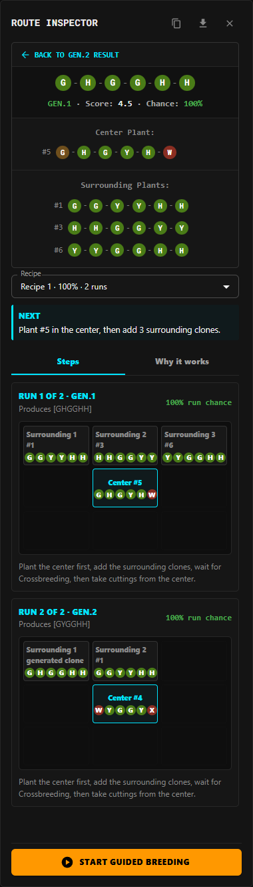

</details>

Rust Genetics Lab combines clone inventory management, target design, route calculation, a 3D planter guide, livestock genetics, farm planning, recipes, and step-by-step execution in one workspace. It runs as a standalone web app and inside RustPlusDesktop.

> [!NOTE]
> Rust Genetics Lab is an unofficial community project. It is not affiliated with or endorsed by Facepunch Studios.

## Highlights

| Capability | What it provides |
| --- | --- |
| Inventory-aware solver | Ranks single-generation and multi-generation routes against the clones you own, including missing-clone requirements. |
| Flexible breeding goals | Choose a preset, enter an exact six-gene target, require minimum genes, or search for the best available result. |
| Actionable route inspector | Review the result, recipe alternatives, source positions, clickable generated-parent sub-plans, ordered planter runs, and why each route works. |
| Search controls | Switch between fast, balanced, and thorough calculation profiles, then sort, filter, group, or compare the results. |
| OCR scanner | Capture genetics from Rust with calibration, correction, preview, and reusable scanner presets. |
| Breeding Mode | Follow a route in game through a focused sequence of planting and confirmation steps, with the current generation shown in a 3D planter that follows your checkboxes. |
| 3D planter guide | Walk through your own route in Rust's real large, small and triangle planters: where each clone goes, genes flowing into the centre, and the clone you end up with. Click any plant for its genes. |
| Plant picker | Switch crops from a grid of item icons that shows how many clones you have saved for each plant. |
| Livestock genetics (beta) | Scan cows, bulls and sheep from Rust, see what each animal's genes do and what it sells for, and get breeding pair suggestions with the expected newborn gene by gene. |
| Recipes | Browse tea, pie, food and resource recipes, including the livestock-update pies, breads and teas, and scale ingredient totals for a run. |
| Genetics guide | Learn growth stages, gene weights and planter layouts, with interactive 3D models of every planter and plant. |
| Updates and patch notes | A banner announces a new version with its release notes; patch notes are always one click away, and a "What's new" dialog appears after an update. |
| Goal-based farm planner | Start with cloth, berries, tea, food, or pie output. Get the required crops, planters, clone reserve, first harvest, and steady production. |
| Farm setup audit | Enter an existing farm's water, power, slots, genetics, and conditions. The audit names the limiting system and the smallest useful correction. |
| Build requirements | Generate planter modules, water and power demand, component counts, estimated crafting materials, and a checklist that can be copied, printed, or exported. |
| Connected tools | Expand recipe goals through the recipe engine, check owned clones, or send missing genetics straight to the Breeding Workspace. |

## Workflow

1. Pick the plant at the top left, then enter clone genetics manually, paste a list, restore a saved set, or scan from Rust.
2. Define the breeding goal.
3. Calculate routes and choose the best plan for the clones currently available.
4. Review the result and ordered planter runs, check the layout in the 3D planter guide, then start guided Breeding Mode.

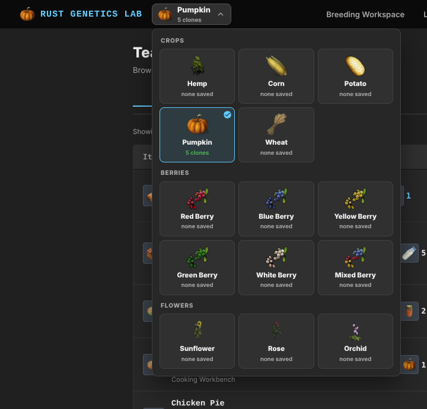

The clone numbers shown in a route match their positions in the input list, which makes the list usable as a direct model of an in-game storage box.

## 3D Planter Guide

The guide on the **Genetics Guide** tab, and the **Planter Guide** button on a route, show the plan in Rust's own planter and plant models. It follows the plant picked at the top left and walks through your selected route, or the best one, one generation at a time. With no routes calculated it shows a worked example computed by the same solver.

- **Breeding steps**: plant the centre, grow it to sapling, plant the donors (with tie-break order), and take cuttings of the result. Genes flow from each donor into the centre.
- **Slot layout**: hover or click any slot of the large (9), small (3) or triangle (4) planter to see which slots cross with it.
- **Growth stages**: seed to dying. Pumpkin uses its real model for every stage; other plants are scaled.
- Click any plant for its genes and what it gives to or takes from its neighbours. Orbit, zoom, auto-rotate, reset the view or go full screen.

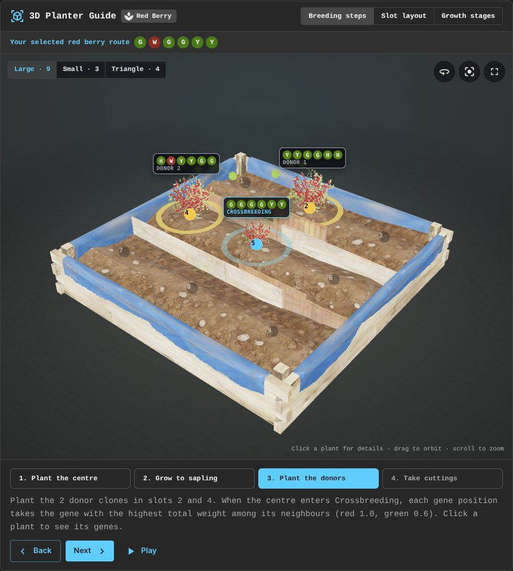

<details>
<summary>Slot layout, growth stages and guided breeding</summary>

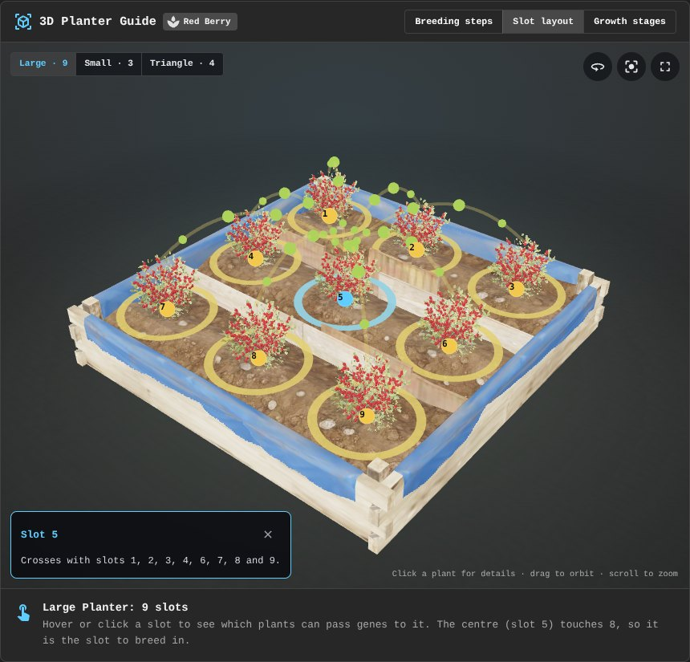

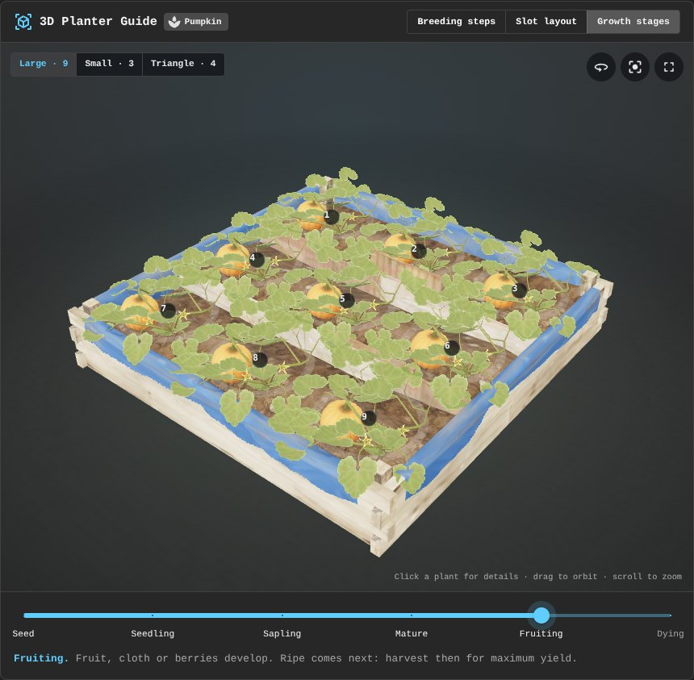

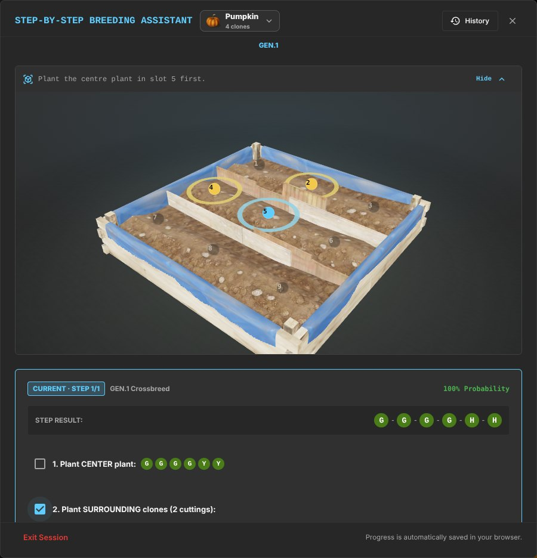

</details>

The 3D view loads only when it is shown, redraws only while something moves, and falls back to the 2D layout where WebGL is unavailable.

## Livestock Genetics (Beta)

Scan cows, bulls and sheep straight from the in-game panel; no calibration is needed. The scanner reads the genes, name, marker number, age and condition, detects the animal's kind from its portrait, and never adds the same animal twice. Animals can also come from a phone camera or be added by hand.

- **Animal**: what each gene does at Bad, Ok and Good, and what the animal sells for.
- **Pair suggestions**: the pairs worth breeding, with the expected newborn shown gene by gene, accounting for hidden gene copies and inbreeding.
- **Rules**: taming and trust, gene effects, inbreeding, dung and biofuel, and selling.

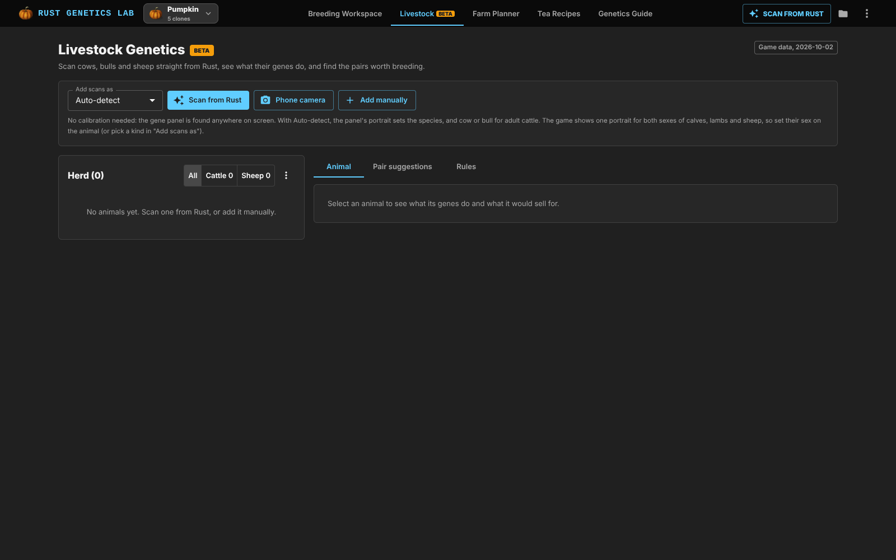

## Recipes

Browse tea, pie, food and resource recipes and scale the ingredient totals to 1x, 5x, 10x or 50x. Farm Planner goals expand through the same recipe engine.

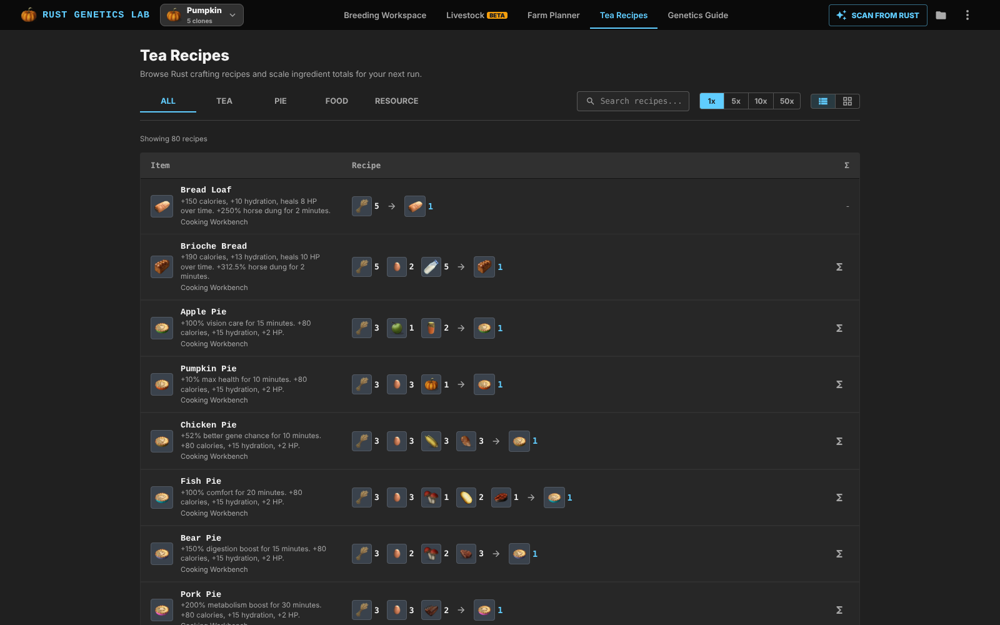

## Updates and Patch Notes

When a new version is available, a banner shows its release notes and a **Reload now** button. After the update, a "What's new" dialog lists every change since the version you last used. **Patch notes** in the header menu and in **About** show the full history at any time.

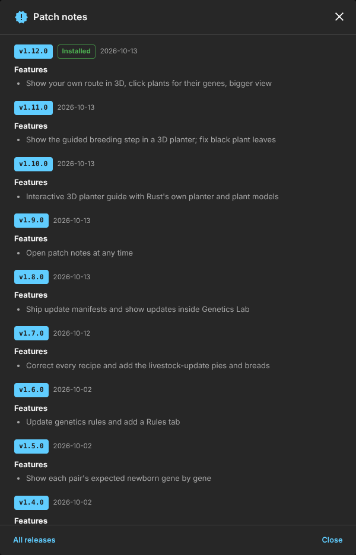

## Farm Operations Planner

The planner works backward from a production target. Choose the output, quantity, time window, genetics, planter type, and infrastructure assumptions. The result separates community crop estimates from user-measured calibration and keeps water flow distinct from electrical power.

### Plan by goal

Size a farm for a raw crop or an existing tea and food recipe. The recommendation includes planter allocation, clone reserve, first harvest, output rate, water, power, layout modules, and a build checklist.

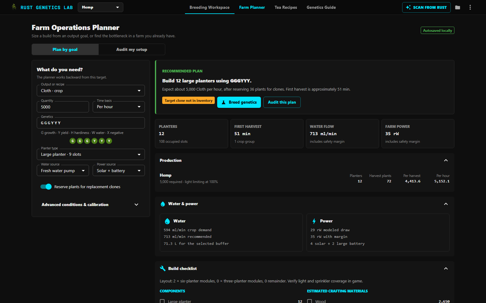

### Audit an existing setup

Enter measured water and power capacity to test a farm before expanding it. The audit identifies the primary bottleneck, shows the margin, and recommends a concrete correction.

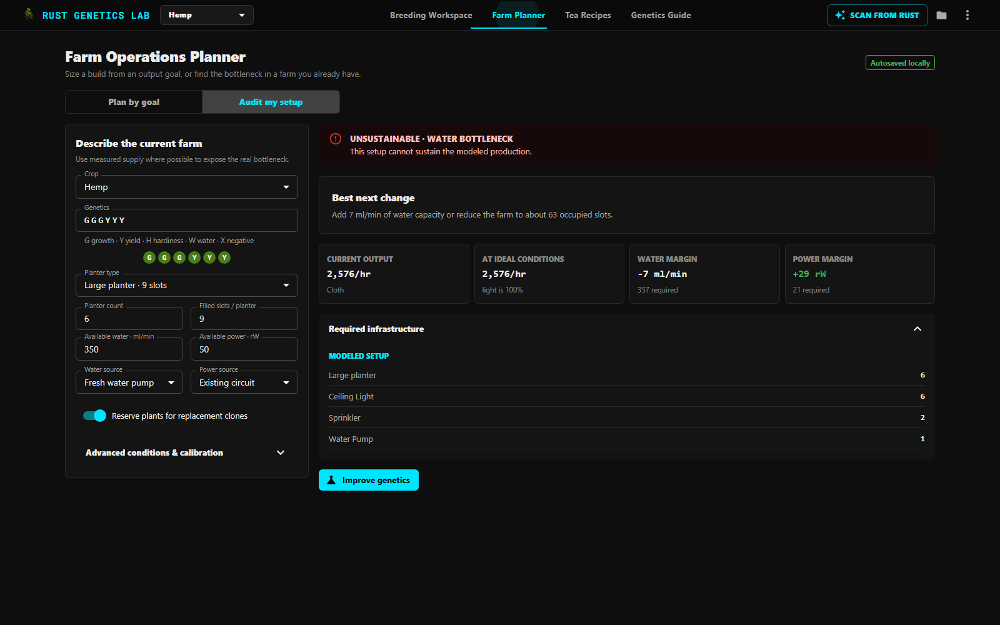

Farm drafts and checklist progress are saved locally. Plans can move directly into the recipe browser or Breeding Workspace without re-entering the target.

## Getting started

### Prerequisites

- A current [Node.js](https://nodejs.org/) LTS release
- npm

### Install and run

```bash
git clone https://github.com/JawadYzbk/rust-genetics-lab.git
cd rust-genetics-lab
npm ci
npm run dev
```

Open the local URL printed by Vite.

### Available commands

| Command | Purpose |
| --- | --- |
| `npm run dev` | Start the Vite development server. |
| `npm run build` | Type-check the project and create a production build. |
| `npm run preview` | Serve the production build locally. |
| `npm test` | Run the Vitest test suite once. |

## Desktop integration

The standalone build supports the complete planning workflow in a browser. When hosted by RustPlusDesktop through WebView2, the same interface can use the desktop scanner bridge for a tighter capture workflow.

RustPlusDesktop keeps its embedded copy current on its own, whatever desktop version is installed. Every build ships `genetics-lab-manifest.json`, listing each file's SHA-256 and the recent changelog. The desktop compares it with the latest release's manifest on the `dist` branch (or on the hosted site when GitHub cannot be reached) and downloads only the files that changed.

## Releases

A push to `master` with a `feat:` or `fix:` commit bumps the version, updates the changelog, tags the release and starts the `Release` workflow. That workflow builds the site, publishes the build to the `dist` branch (tagged `dist-vX.Y.Z`) for desktop updates, attaches the bundle and manifest to the GitHub release, and deploys the website to Coolify. See [DEPLOYMENT.md](DEPLOYMENT.md).

## Privacy

Genetics, saved sets, projects, and settings are stored locally in the browser. OCR and route calculation run on the device. Anonymous usage analytics is enabled by default and can be disabled at any time from the privacy settings.

## Technology

- [React](https://react.dev/) and [TypeScript](https://www.typescriptlang.org/)
- [Vite](https://vite.dev/)
- [Material UI](https://mui.com/) and [Emotion](https://emotion.sh/)
- [Tesseract.js](https://tesseract.projectnaptha.com/) for client-side OCR
- [three.js](https://threejs.org/) for the 3D planter guide
- Web Workers for solver concurrency
- [Vitest](https://vitest.dev/) for automated tests

## Contributing

Issues and focused pull requests are welcome. Before submitting a change, run:

```bash
npm test
npm run build
```

Please include a short explanation of the user-facing change and screenshots for visual updates.

## Acknowledgements

Rust Breeder inspired the project's early direction. Rust Genetics Lab has since grown into an independent solver and breeding workspace.

The planter and plant models come from Facepunch's [RustRelay.Assets](https://github.com/Facepunch/RustRelay.Assets) and are used under the [Facepunch Terms of Service](https://facepunch.com/legal/tos); see [public/models/README.md](public/models/README.md).

## License

Copyright 2026 Jawad Yazbek and contributors.

Licensed under the [Creative Commons Attribution-NonCommercial-ShareAlike 4.0 International License](LICENSE). Commercial use is not permitted, and derivative work must use the same license.
